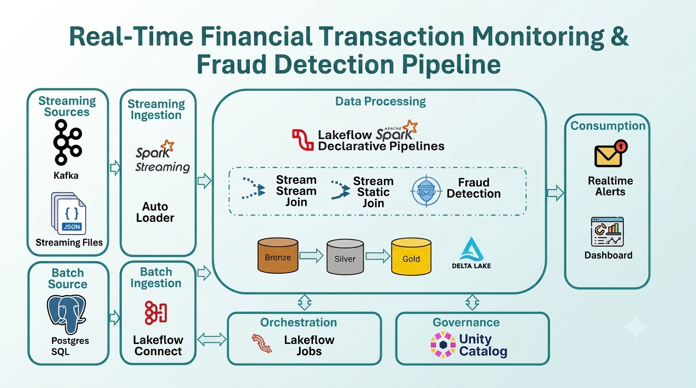

# Financial_Transactions_Real_Time_Fraud_Detection_Pipeline

An end-to-end real-time financial transaction monitoring and fraud detection platform built using Apache Kafka, Confluent Cloud, PySpark and Databricks Lakeflow Spark Declarative Pipelines.

FinGuard ingests financial transactions and fraud watchlist data, processes them through a Bronze-Silver-Gold architecture, identifies suspicious activities and generates automated email alerts.

## Project Architecture



### Architecture Overview

1. **Transaction Generation:** Python-based producer generates simulated credit card transactions and publishes events to Confluent Kafka.
2. **Streaming Ingestion:** Databricks reads transaction events from Kafka using Spark Structured Streaming.
3. **Fraud Watchlist Ingestion:** Databricks Auto Loader continuously ingests JSON files containing fraud watchlist information.
4. **Customer Data Ingestion:** Customer information is sourced from PostgreSQL and ingested using Lakeflow Connect.
5. **Data Processing:** Lakeflow Spark Declarative Pipelines processes data using the Medallion Architecture.
6. **Fraud Detection:** Streaming joins, customer enrichment and fraud detection rules identify suspicious transactions.
7. **Alerting:** Custom foreachBatch sinks send automated email notifications using Gmail SMTP.
8. **Analytics:** Gold-layer tables support transaction aggregations and Databricks dashboards.

## Technology Stack

| Component | Technology |
|---|---|
| Programming | Python, PySpark |
| Streaming Platform | Apache Kafka, Confluent Cloud |
| Stream Processing | Spark Structured Streaming |
| Data Engineering | Databricks Lakeflow Spark Declarative Pipelines |
| File Ingestion | Databricks Auto Loader |
| Storage | Delta Lake |
| Medallion Architecture | Bronze, Silver, Gold |
| Relational Database | PostgreSQL |
| Data Governance | Unity Catalog |
| Alerting | Gmail SMTP, foreachBatch |
| Analytics | Databricks AI/BI Dashboards, Genie |

## Data Pipeline Implementation

### 1. Transaction Generation and Kafka Ingestion

- Developed a Python Kafka producer using the Confluent Kafka client.
- Generated simulated financial transaction events.
- Published transaction records to the `credit_card_transactions` topic.
- Configured Kafka authentication using SASL_SSL and SASL/PLAIN.

### 2. Bronze Layer – Raw Ingestion

- Ingested transaction events from Confluent Kafka.
- Used Databricks Auto Loader to ingest fraud watchlist JSON files.
- Captured source metadata and ingestion timestamps.

### 3. Silver Layer – Data Transformation

- Parsed incoming JSON transaction records using PySpark.
- Applied schema validation and data quality expectations.
- Normalized fraud watchlist data.
- Processed customer information for downstream enrichment.

### 4. Gold Layer – Fraud Detection and Analytics

- Implemented stream-stream joins between transactions and fraud watchlist records.
- Used watermarking to handle late-arriving events.
- Enriched transactions with customer information.
- Identified high-value transactions based on customer transaction limits.
- Implemented tumbling and sliding-window aggregations for transaction analytics.

### 5. Automated Fraud Alerts

- Developed custom `foreachBatch` sinks.
- Integrated Gmail SMTP for email notifications.
- Generated alerts for suspicious transactions matching fraud watchlist criteria.

### 6. Analytics and Dashboard

- Created Gold-layer analytics tables.
- Built transaction monitoring dashboards using Databricks AI/BI and Genie.

## Key Concepts Implemented

- Kafka producers and consumers
- Spark Structured Streaming
- Auto Loader and incremental file ingestion
- Medallion Architecture
- Delta Lake
- Stream-stream joins and stream-static joins
- Event-time processing and watermarking
- Tumbling and sliding-window aggregations
- Data quality expectations
- foreachBatch streaming sinks
- Automated email notifications

## Project Setup

### Prerequisites

- Python 3.x
- Confluent Cloud account
- Databricks workspace
- PostgreSQL database
- Gmail account with an app password for SMTP notifications

### 1. Clone the repository

```bash
git clone https://github.com/YOUR_USERNAME/finguard-real-time-fraud-detection.git

cd finguard-real-time-fraud-detection
```

### 2. Create a Python environment

```bash
python -m venv .venv
```

Activate it:

Windows:

```bash
.venv\Scripts\activate
```

Linux/macOS:

```bash
source .venv/bin/activate
```

### 3. Install dependencies

```bash
pip install -r requirements.txt
```

### 4. Configure credentials

Configure Kafka connection details and Gmail credentials using Databricks Secret Scopes.

Do not hardcode credentials in source files or commit secrets to GitHub.

### 5. Run the Kafka producer

Configure the required Kafka connection settings and run:

```bash
python producer_normal.py
```

### 6. Deploy and execute Databricks pipelines

Import or connect the Databricks source files to your workspace, configure the required Unity Catalog permissions and source paths, and execute the relevant pipelines and workflows.

Note: Cloud resources, credentials, catalogs, schemas, volumes and pipeline configurations must be configured in your own environment.

## Project Outcomes

- Built an end-to-end streaming data pipeline integrating Kafka and Databricks.
- Implemented incremental ingestion from both Kafka and JSON file sources.
- Developed fraud detection logic using streaming joins and customer enrichment.
- Implemented event-time window aggregations.
- Automated fraud alert notifications through email.
- Created analytics-ready Gold tables and dashboards.

## Future Enhancements

- Introduce more advanced fraud detection models.
- Add centralized pipeline monitoring and alerting.
- Implement an idempotent alert delivery mechanism.
- Add automated testing and CI/CD deployment.

## Author

Jignesh Purabiya

Data Engineer | PySpark | Apache Kafka | Databricks | SQL

[LinkedIn](linkedin.com/in/jignesh-purabia-a166971ba) | [GitHub](https://github.com/JigneshPurabiya26)
